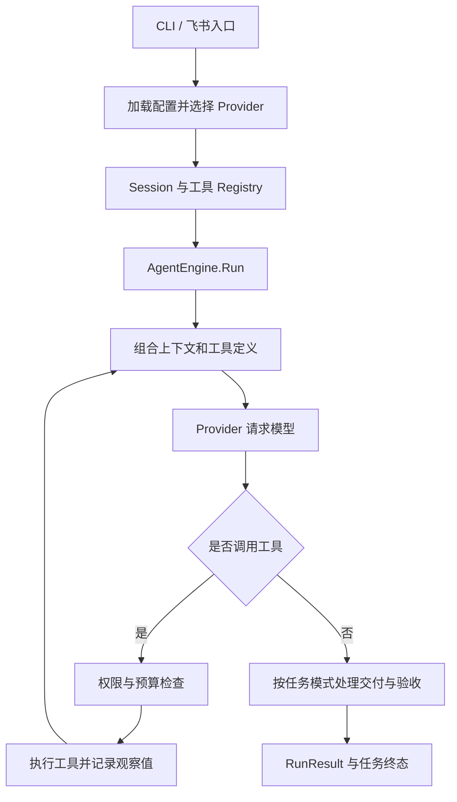

[返回首页](../README.md) · [文档导航](README.md)

# 架构与源码导读

go-agent-claw 将模型决策、工具执行和程序约束分开：模型提出下一步动作，引擎判断能否执行、记录结果，再把观察值交回模型。学习时可以先跟踪一个只读任务，再逐步阅读预算、恢复和证据分支。

## 一次任务如何流转

每轮请求还受取消、时间、存储和上下文上限约束。计划、质量核验等显式能力会在主流程中增加对应阶段，不能假定所有任务都经过同样数量的模型请求。

## 模块职责

| 位置 | 职责 |
| --- | --- |
| [cmd/claw](../cmd/claw/main.go) | 解析 CLI、加载环境、创建 Session、Provider、Registry 和引擎 |
| [schema](../internal/schema/message.go) | 消息、角色、工具调用和用量等共享类型 |
| [provider](../internal/provider/interface.go) | `LLMProvider.Generate` 接口与协议适配 |
| [engine](../internal/engine/loop.go) | ReAct 主循环、计划、预算、委派、恢复和交付 |
| [context](../internal/context/session.go) | Session、工作记忆、压缩、提示词和技能目录 |
| [tools](../internal/tools/registry.go) | 工具定义、准入、中间件与执行 |
| [taskstore](../internal/taskstore/store.go) | 持久事件、检查点、材料和工作区锁 |
| [observability](../internal/observability/tracker.go) | 包装 Provider 统计用量与成本；同目录维护 Trace |
| [feishu](../internal/feishu/bot.go) | 独立群聊入口、队列、审批和消息交付 |
| [cmd/bench](../cmd/bench/main.go) | 使用真实模型执行测试任务与验收 |

依赖向内流动，`schema` 保持独立；引擎编排其他模块，工作区挂在 Session 上。文件工具结合 ExecutionScope 和工作区根句柄访问文件，不能仅靠模型遵守提示词。

## 模型和工具如何衔接

Provider 将内部消息翻译成渠道协议。内部工具结果使用带 `ToolCallID` 的 `RoleUser` 消息回传，没有独立 tool 角色；Provider 负责转换为对应 API 结构。工具参数保存为 `json.RawMessage`，由各工具解析。

Registry 提供模型可见的工具定义，并通过 `Registry.Use` 中间件控制准入。引擎将连续的独立只读工具调用限量并发，写入与 Bash 作为顺序屏障。相同工作区的持久任务由工作区锁保护。

CLI、Bench 和飞书通过 [ResolveModelConfig / NewConfiguredProvider](../internal/provider/configured.go) 选择渠道。目前入口使用 OpenAI 兼容适配；[claude.go](../internal/provider/claude.go) 保留 Anthropic 兼容实现，新增入口接线需要自行装配。具体模型配置见[配置指南](configuration.md)。

## 推荐阅读顺序

首遍建议从[无密钥课程](learning/01-react.md)观察实际输出。只追踪装配、模型请求、工具分发、观察返回和停止；理解主线后，再按具体问题进入报告、质量、读取实验及历史恢复分支。[保证边界](mechanism-boundaries.md)列出这些机制的实现层次。

1. `cmd/learn/main.go`、`internal/learning/basic.go`：用固定候选看真实引擎装配，再到 `cmd/claw/main.go` 区分真实模型配置、CLI 参数与 `TaskSpec`。
2. `internal/engine/types.go`、`loop.go`：理解 `NewAgentEngine(provider, registry, EngineOptions)` 和 `Run(ctx, session, TaskSpec, reporter)`。
3. `internal/provider/interface.go`、`openai.go`：看一次模型请求怎样编码和返回。
4. `internal/tools/registry.go`、`read_file.go`：看工具如何定义、校验参数并执行。
5. `internal/context/session.go`、`compactor.go`：理解上下文如何变短并保持消息配对。
6. 继续读[恢复与验收](tasks-and-recovery.md)、[计划与委派](planning-and-delegation.md)，再研究证据和质量分支。

交流时可挑一个具体问题，例如“工具失败后模型如何收到纠正提示”，从 [RecoveryManager](../internal/context/recovery.go) 反向追踪主循环，比一开始通读所有文件更容易验证理解。
